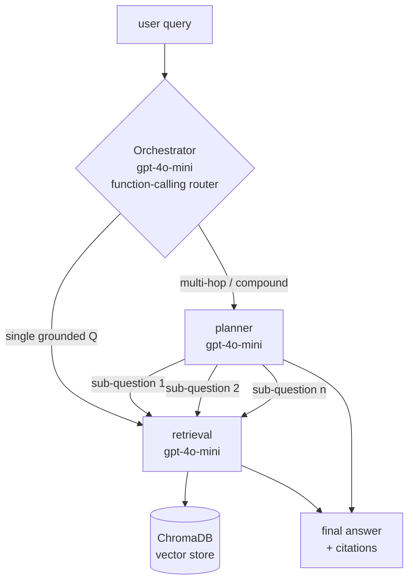

# Plan — agentic-chat-system

## Goal
RAG chat over uploaded documents, fronted by an orchestrator that routes to specialized sub-agents.

## Architecture



## Agents

| Agent        | Model        | When invoked                                  | Outputs                          |
|--------------|--------------|-----------------------------------------------|----------------------------------|
| orchestrator | gpt-4o-mini  | every turn                                    | routes to planner / retrieval    |
| planner      | gpt-4o-mini  | multi-hop / decomposable questions            | ordered sub-questions            |
| retrieval    | gpt-4o-mini  | grounded Q&A over Chroma                      | answer + cited sources           |

**Why gpt-4o-mini everywhere for now**: routing, retrieval, and summarization are mechanical; cost dominates. Bump any agent to `gpt-4o` later if accuracy suffers.

## Routing logic (supervisor)

Orchestrator prompt exposes two tools via LangChain function-calling:
- `call_planner(question)` — for compound / multi-doc questions
- `call_retrieval(question)` — default; single grounded answer

Heuristics baked into the orchestrator system prompt:
- short, single-topic question → `retrieval`
- contains "compare", "summarize across", "list all", multiple entities → `planner`
- chitchat / no-doc question → `retrieval` (which will answer "I don't know")

## File layout

```
backend/app/
├── main.py            FastAPI routes
├── config.py          env settings (models, paths, top_k)
├── vectorstore.py     Chroma wrapper
├── ingest.py          load + split documents
├── qa.py              single-shot retrieval (used by retrieval agent)
├── agents/
│   ├── __init__.py
│   ├── state.py       GraphState (TypedDict)
│   ├── retrieval.py   retrieval_agent node
│   ├── planner.py     planner_agent node
│   └── orchestrator.py LangGraph supervisor wiring
└── requirements.txt
```

## Build order

1. `state.py` — shared `GraphState` (`messages`, `next_agent`, `sub_questions`)
2. `retrieval.py` — wrap existing `qa.answer` as a node
3. `planner.py` — LLM that returns `List[str]` of sub-questions
4. `orchestrator.py` — LangGraph `StateGraph` with supervisor + 2 workers, conditional edges
5. `main.py` — replace `/chat` route with `graph.invoke(...)`
6. Frontend: surface agent routing in UI (small chip: "via retrieval" / "via planner")

## Non-goals (v1)
- web search, code execution
- persistent chat history (in-memory per session)
- streaming responses (add later with `astream_events`)
- auth / multi-tenant

## Open questions
- Replace Chroma with ClickHouse vector search? (ClickHouse has `VectorSearch` since 24.x; would need schema + SQL rewrite.)
- Swap any sub-agent to GPT-4o? — start with mini, measure, decide.