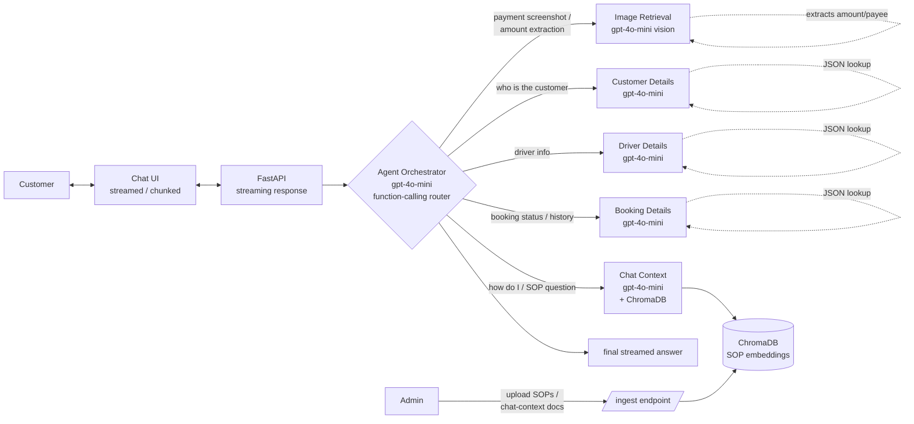
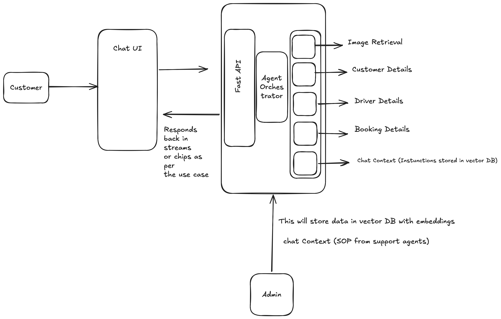

# Plan — agentic-chat-system

## Goal
Customer-support chat: customer asks via chat UI, orchestrator routes to one of five specialized sub-agents, response streamed back. Admin separately ingests SOPs/chat-context into a vector DB for the SOP agent.

## Architecture





## Agents & models

| Agent | Model | When invoked | Backing store |
|---|---|---|---|
| **Orchestrator** | `gpt-4o-mini` | every turn — routes by intent | — |
| **Image Retrieval** | `gpt-4o-mini` (vision) | user attaches an image (e.g. payment screenshot) — extracts amount/payee/date/txn-id | none (in-process extraction) |
| **Customer Details** | `gpt-4o-mini` | questions about a customer (name, contact, history) | `data/customers.json` |
| **Driver Details** | `gpt-4o-mini` | questions about a driver (assignment, status) | `data/drivers.json` |
| **Booking Details** | `gpt-4o-mini` | questions about a booking (status, route, fare) | `data/bookings.json` |
| **Chat Context (SOP)** | `gpt-4o-mini` | "how do I…", policy / procedure questions | ChromaDB |

**Why mini everywhere**: orchestrator routes, every sub-agent is either a structured lookup or a grounded RAG answer — none needs `gpt-4o` reasoning. Bump individual agents later if accuracy suffers.

## Routing rules (orchestrator prompt)

- contains an image attachment → `image_retrieval`
- mentions customer / passenger / "their info" → `customer_details`
- mentions driver / "my driver" → `driver_details`
- mentions booking / trip / ride / fare → `booking_details`
- "how do I", "policy", "what is the process for", general SOP → `chat_context`
- ambiguous / chitchat → `chat_context` (will answer "I don't know" if no SOP hit)

## Data (mock JSON, no DB)

```
data/
├── customers.json     [{id, name, phone, email, ...}]
├── drivers.json       [{id, name, vehicle, status, ...}]
├── bookings.json      [{id, customer_id, driver_id, status, fare, ...}]
├── chroma/            persisted SOP embeddings (gitignored)
└── uploads/           admin-ingested SOP files (gitignored)
```

## Endpoints

| Method | Path | Purpose | Caller |
|---|---|---|---|
| GET | `/health` | health check | — |
| POST | `/chat` (SSE stream) | streamed customer chat response | Chat UI |
| POST | `/ingest` (multipart) | admin uploads SOP/chat-context docs → Chroma | Admin |
| POST | `/upload-image` (multipart) | temporary image for vision extraction | Chat UI (via `/chat` payload) |

## File layout

```
backend/app/
├── main.py                 FastAPI: /health, /chat (SSE), /ingest
├── config.py               env settings
├── data/                   loads JSON mock data
│   ├── customers.py
│   ├── drivers.py
│   └── bookings.py
├── vectorstore.py          Chroma wrapper (SOP collection)
├── ingest.py               SOP file load + split
├── vision.py               gpt-4o-mini vision extraction helper
├── agents/
│   ├── __init__.py
│   ├── state.py            GraphState (TypedDict) — messages, route, image_ref
│   ├── image_retrieval.py  vision node
│   ├── customer.py         customer lookup node
│   ├── driver.py           driver lookup node
│   ├── booking.py          booking lookup node
│   ├── sop.py              SOP RAG node
│   └── orchestrator.py     LangGraph supervisor wiring (5 workers, conditional edges)
└── requirements.txt
```

## Build order

1. `data/*.py` — load JSON fixtures
2. `vectorstore.py` + `ingest.py` — SOP ingestion path (already partially done)
3. `vision.py` — `gpt-4o-mini` image extraction helper
4. `agents/*.py` — five sub-agent nodes
5. `agents/orchestrator.py` — LangGraph `StateGraph` with supervisor + 5 workers
6. `main.py` — `/chat` SSE streaming, `/ingest` admin path
7. Frontend: image upload, agent-routing chip in UI

## Non-goals (v1)
- real DB (Postgres / SQL) — JSON fixtures only
- real-time driver location / booking APIs — static fixtures
- multi-tenant / auth
- persistent chat history across sessions

## Open questions
- Streaming format: SSE vs WebSocket? (SSE simpler for FastAPI → fetch EventSource on frontend)
- Vision prompt: structured JSON output via `response_format={"type":"json_object"}` for predictable schema.
- Should `chat_context` agent also see conversation history (multi-turn SOP Q&A) or only the latest question?